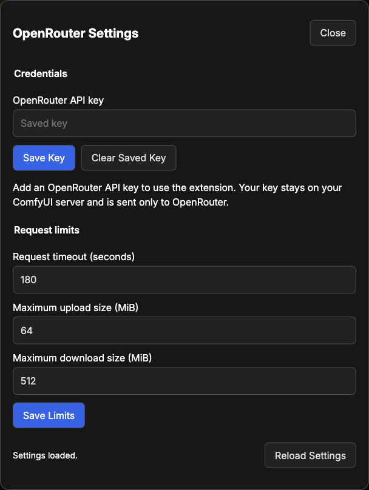

# ComfyUI OpenRouter Advanced Guide

## Contents

- [What each node sends](#what-each-node-sends)
- [Keys and access](#keys-and-access)
- [Settings](#settings)
- [Models](#models)
- [Caching and reruns](#caching-and-reruns)
- [Recover a video](#recover-a-video)
- [Limits](#limits)
- [When a node stops](#when-a-node-stops)
- [Use from another extension](#use-from-another-extension)
- [Update or remove](#update-or-remove)
- [Development](#development)
- [Package and publish](#package-and-publish)
- [Troubleshooting](#troubleshooting)

## What each node sends

- **Chat: Ask** sends the prompt and the media: images as PNG, videos as MP4,
  and audio as WAV. PDFs go to the PDF engine of OpenRouter; text files go as
  text. Earlier turns come from `conversation`.
- **Chat: Ask** returns the text, the reasoning when the model shares it, and
  any images the model made. Speech comes back as 24 kHz mono PCM.
- **Image: Generate** sends the prompt, the chosen settings, the count, and each
  reference image as PNG. It returns images, their masks (white is
  transparent), and SVG files.
- **Video: Generate** sends the prompt, the chosen settings, and the frames or
  references. It records the job as soon as OpenRouter accepts it, checks it
  every 30 seconds, and downloads the MP4 when it is ready.
- **Video: Download** checks one recorded job and downloads its video. Status
  checks and downloads are free.
- **Audio: Speak** sends the text, the voice, the speed, and a connected
  `voice_sample` as WAV. It returns the audio as PCM or MP3.
- **Audio: Transcribe** sends the clip as WAV, and the language and the
  timestamps you ask for. It returns the text, the segments, SRT subtitles, and
  the timed words.
- **Search: Embed** sends every text line and image in one request. It compares
  each embedding with the first one locally.
- **Search: Rank** sends the query and every text line and image in one request.
  It returns them in order, with their scores.
- **Decision: Ask** sends the situation and the questions to OpenRouter's alpha
  decisions API. **Decision: Read Answer** reads one answer locally.
- **Request Options** adds its settings to the request of each paid node it
  connects to.
- **Model: Info** reads a model's public listings, without the key, and returns
  them as JSON.

Every request goes out once. Requests that take provider routing send
`allow_fallbacks: false`, so OpenRouter never moves one to another provider.

## Keys and access

Save the key in **OpenRouter Settings**: in the ComfyUI menu, open
**Extensions**, then **OpenRouter**, then **OpenRouter Settings**. The extension
keeps it in the private folder, and the first request that uses it checks it.
`OPENROUTER_API_KEY`, set where ComfyUI starts, takes precedence.

Only a direct local connection to the ComfyUI server can change the key and
the settings. For remote access, a reverse proxy, or multi-user mode, set
`OPENROUTER_API_KEY` instead.

The private folder is:

| System  | Folder                                               |
| ------- | ---------------------------------------------------- |
| macOS   | `~/Library/Application Support/OpenRouterComfyUI`    |
| Linux   | `${XDG_STATE_HOME:-~/.local/state}/openrouter-comfy` |
| Windows | `%LOCALAPPDATA%\OpenRouterComfyUI`                   |

To use another folder, set `OPENROUTER_COMFY_STATE_DIRECTORY` to an absolute
path outside the extension and the folders of ComfyUI. The extension writes the
files unencrypted, with owner-only permissions.

## Settings

Change these in **OpenRouter Settings**. New requests use the saved values.



| Setting                     | Default | Range      | What it limits                                          |
| --------------------------- | ------- | ---------- | ------------------------------------------------------- |
| Request timeout (seconds)   | 180     | 10 to 3600 | How long one generation may take; for a video, the job. |
| Maximum upload size (MiB)   | 64      | 1 to 512   | The media and documents in one request.                 |
| Maximum download size (MiB) | 512     | 16 to 4096 | The largest reply, image, audio, or video accepted.     |

## Models

Before it sends, a paid node reads the public listings of OpenRouter. It stops
before you pay anything when:

- the model ID is empty or unknown;
- the model makes something the node does not return, such as a video model in
  **Image: Generate**;
- connected images, video, or audio are media the model does not read;
- **Chat: Ask** asks for images or audio the model does not make, or a sampling
  setting or `stop` the model does not take. It also stops for a `json_schema`
  the model cannot follow, or more `max_tokens` than its longest answer;
- **Audio: Speak** has `voice_sample` connected and the model cannot clone
  voices;
- **Image: Generate** asks for a value, `count`, or number of `references` the
  model's entry in OpenRouter's image list does not take;
- **Video: Generate** uses a `duration`, `resolution`, `aspect_ratio`,
  `generate_audio`, `upscale_factor`, `creativity`, `first_frame`, or
  `last_frame` the model's entry in OpenRouter's video list does not take.

The message names what the model does take. A node reads each listing once per
model per ComfyUI session. **Model: Info** returns the same listing as JSON, and
costs nothing.

`seed` and `reasoning_effort` go only to models that list them. With a sampling
setting, `stop`, or a `json_schema`, only providers that take every one of them
answer. A
`reasoning_effort` the model does not list steps down to the highest one it
lists below it, or up to its lowest. A node sends every other setting only when
you change it from `default` or `0`.

| Node              | Default model, by its page on OpenRouter            |
| ----------------- | --------------------------------------------------- |
| Chat: Ask         | `openrouter.ai/google/gemini-3.5-flash`             |
| Image: Generate   | `openrouter.ai/google/gemini-3.1-flash-image`       |
| Video: Generate   | `openrouter.ai/google/veo-3.1-fast`                 |
| Audio: Speak      | `openrouter.ai/google/gemini-3.1-flash-tts-preview` |
| Audio: Transcribe | `openrouter.ai/openai/whisper-large-v3-turbo`       |
| Search: Embed     | `openrouter.ai/openai/text-embedding-3-small`       |
| Search: Rank      | `openrouter.ai/cohere/rerank-v3.5`                  |
| Decision: Ask     | `openrouter.ai/typesafe/jev-1.13`                   |

Each model ID is the path after `openrouter.ai/`. **Audio: Speak** starts with
`voice` set to `Kore`, which its default model
needs.

## Caching and reruns

- Change `run_number` to send the same request again.
- A `seed` that is not `fixed` changes after each run, so running again sends a
  new request. The examples use `fixed`.
- Saving a different key invalidates the cached results; changing settings does
  not.
- A node sends every request once.
- Cancelling stops the wait only: a chat model still bills the tokens it
  produced, and a video job keeps running.

## Recover a video

**Video: Generate** records each job as soon as OpenRouter accepts it. The job
runs to completion even when you cancel, ComfyUI restarts, or the request
timeout passes. Collect it with **Video: Download**; press R to list new
jobs. A job leaves the list once the node downloads its video, or when
OpenRouter reports the job as failed, cancelled, or expired.

## Limits

The extension adds no limits of its own to what a request holds. Only your
settings apply: the upload and download sizes and the request timeout in
**OpenRouter Settings**. **Model: Info** reports each model's listed limits,
and OpenRouter refuses a request outside them.

## When a node stops

Paid nodes check these before sending, along with the [model checks](#models).

**Chat: Ask** stops when:

- `prompt` is empty.
- The media are over the upload limit.
- `json_schema` is not a JSON object.
- An input other than `images`, `videos`, or `audio` receives a list of several
  values. The same holds for the media nodes below.

**Chat: Attach Document** stops when:

- `file` names no file, or a file outside the input folder.
- The file is not a PDF or text file, is over the upload limit, or is not UTF-8
  text.

**Image: Generate** stops when:

- `prompt` is empty.
- `background` is `transparent` and `output_format` is `jpeg`.

**Video: Generate** stops when:

- `prompt` is empty and `first_frame` is not connected.
- Frames and references are both connected, or a frame receives more than one
  image.

**Audio: Speak** stops when `text` is empty, or `voice_sample` is over the
upload limit. **Audio: Transcribe** stops when `language` is not a two-letter
code, or `audio` is a batch.

**Search: Embed** and **Search: Rank** stop when there are no items. **Search:
Rank** also stops when `query` is empty.

**Decision: Add Question** stops when `name` is invalid or used twice,
`instructions` is empty, or the fields of `answer_type` are incomplete.

**Decision: Ask** stops when `situation` is empty. OpenRouter refuses a
situation longer than the model reads. **Decision: Read Answer** stops when no
question has the name in `question`.

**Request Options** stops when it cannot read a provider list or a JSON field.
A paid node stops when the options include a setting its request does not
accept.

## Use from another extension

Another extension can call these nodes instead of copying their choices or a
model's limits:

```python
clone = nodes.NODE_CLASS_MAPPINGS["OpenRouterModelInfo"].PREPARE_CLASS_CLONE(None)
clone.hidden = io.HiddenHolder.from_dict({})
output = await clone.execute(model="qwen/qwen-image-3-pro")
listing = json.loads(output.args[0])
```

- Call a node by its ID on a class clone with an empty hidden holder, as above.
  A called node leaves the progress bar of the calling node alone.
- A node that takes input lists, such as **Chat: Ask**, takes every input as a
  one-item list; only its media inputs hold several items.
- Read the choices of a dropdown from the schema of the node, such as
  `/object_info/OpenRouterChatAsk`, instead of copying them.
- Read a model's limits with **Model: Info**.
- A failed request raises an error whose `code` names its kind, such as
  `rate_limited`, `timeout`, or `uncertain`. Check `code`, not the message
  text, which can change.
- Do not send a failed paid request again: it may have run, and OpenRouter may
  have billed it.

## Update or remove

To update, replace the `custom_nodes/openrouter` folder, install its
`requirements.txt` with ComfyUI's Python, and restart. Open the updated
examples in a new tab.

To remove it, move the folder out of `custom_nodes` and restart. The
[private folder](#keys-and-access) stays; delete it to remove the saved key,
settings, and job records.

## Development

Development needs mise. `.mise.local.toml`, which Git ignores, names the
ComfyUI install that the type checker and the schema export read:

```toml
[env]
COMFYUI_PATH = "/path/to/ComfyUI"
COMFYUI_PYTHON = "/path/to/ComfyUI/.venv/bin/python"
```

`mise run setup` installs the tools, the locked dependencies, the gspot tools,
and the Git hooks, and `mise run deps` puts the ComfyUI install on the path of
the project environment.

gspot runs every check, and the Git hooks run it on each commit and push:

```shell
bun run --no-install gspot check
bun run --no-install gspot check --fix
```

`AGENTS.md` lists the rules gspot installs. Change the settings in
`gspot.toml` only with `gspot set`, `add`, `remove`, `ignore`, and `unignore`.

| Change                                    | Then run                                                                  |
| ----------------------------------------- | ------------------------------------------------------------------------- |
| Python code                               | Restart ComfyUI.                                                          |
| `web/scripts/`                            | `mise run comfy:frontend:build`, and commit both outputs.                 |
| A node or a workflow description          | `mise run comfy:workflows:build`, and commit the files it writes.         |
| The runtime dependencies of the extension | `uv run --no-sync python -m scripts.dependencies`, and commit the output. |

The hooks check that the built browser files match `web/scripts/`, and that
every node has a help page naming its real inputs and sits in an OpenRouter
menu. They also check that the examples and subgraphs match their
descriptions, and that `requirements.txt` lists the runtime dependencies of
`pyproject.toml`.

### Generated files

The build writes the example workflows from `scripts/workflows/descriptions/`:
one module per category, the group notes in `notes.py`, the titles in
`texts.py`, and the shared node and model IDs in `nodes.py`. The build reads the
node definitions through the Python of ComfyUI. It also writes every subgraph
to `subgraphs/`, which ComfyUI lists under **Subgraph Blueprints** in its node
library.

### Test a change

Testing is manual: restart ComfyUI after Python changes, or rebuild the
browser files and reload after browser changes, then run the affected
workflows with inexpensive models.

### Code layout

`src/` holds only packages. The `__init__.py` of the extension holds the
`Extension` class that ComfyUI loads.

| Package      | Holds                                                                               |
| ------------ | ----------------------------------------------------------------------------------- |
| `nodes`      | The node classes and the inputs they share                                          |
| `comfy`      | ComfyUI glue: running a request with progress and cancel, media, routes, runtime    |
| `openrouter` | Every request to OpenRouter, the model check, and the one module that sends the key |
| `settings`   | The private settings, their local routes, and the checks that keep them local       |
| `storage`    | The private files: settings, the saved key, and video job records                   |
| `state`      | Records, type aliases, JSON parsing, and the `OpenRouterError` every message uses   |
| `config`     | Constants and messages, with no code                                                |

The build scripts keep their paths in `scripts/paths.py`, the ComfyUI nodes the
workflows use in `scripts/nodes/host.py`, and their type aliases in
`scripts/types.py`.

### Import rules

The import rules in `gspot.toml` keep the packages in layers. Each package
imports only the packages before it:

```text
src.config
src.state
src.storage
src.openrouter | src.settings
src.comfy
src.nodes
```

- Only `src/nodes/`, `src/comfy/`, and the `__init__.py` of the extension
  import ComfyUI. The contract in `pyproject.toml` checks this rule.
- All OpenRouter code is in `src/openrouter/`, and
  `src/openrouter/transport.py` is the one place that sends the key.
- Node names, descriptions, and tooltips are in the `io.Schema` call of each
  node.
- Every other message is a constant in `src/config/messages/`, or in
  `web/scripts/text.ts` for the dialogs. Every other fixed value, such as a
  limit, a step, a file name, or a route, is a constant in `src/config/`.

### Images

The images of the README and of this guide are in `docs/images/`:

- `docs/images/brand/banner.svg`, `docs/images/diagrams/node-map.svg`, and the
  four badges in `docs/images/badges/` are SVG files; edit them as text. They
  use two palettes: the ComfyUI ink `#211927`, panels `#312C34`, edges
  `#413B45`, text `#C2BFB9`, and yellow `#F0FF41`, and the OpenRouter indigo
  `#6366F1`.
- In the node map, a paid node has an indigo bar and a free one a grey bar. An
  arrow is a solid yellow line from an output to the input it feeds; nodes that
  share no link have no arrow.
- The badges under the banner name the ComfyUI, frontend, and Python versions
  and the license, on ink and grey; update them when those change.
- `docs/images/screenshots/image-01-choose-group.png` is the **Choose** group
  of image-01 and its note, at 100% zoom, with link midpoint markers off.
- `docs/images/screenshots/chat-ask-node.png` is a new **Chat: Ask** node, 420
  pixels wide, at 100% zoom.
- `docs/images/screenshots/settings-dialog.png` is the **OpenRouter Settings**
  dialog with default settings and a saved key.

Keep each image under 100 KB, and give it alt text.

### Change text

- **A message:** edit its constant in `src/config/messages/`, and its entry
  under [troubleshooting](#troubleshooting) if it has one.
- **The labels or tooltips of a node:** edit its `io.Schema` call in `src/nodes/`,
  then its help page in `web/docs/`.
- **The dialogs:** edit `web/scripts/text.ts`, then rebuild the browser files.
- **A workflow's notes:** edit `scripts/workflows/descriptions/notes.py`; for
  titles, `texts.py`; for nodes, models, or prompts, the workflow's module. Then
  rebuild the workflows.
- **The default model of a node:** edit `src/config/generation/models.py`,
  then the table under [models](#models) and the help page of the node.

## Package and publish

[comfy-cli](https://github.com/Comfy-Org/comfy-cli) makes the Comfy Registry
package. These steps use version
1.20.0.

1. Create a publisher and a publishing key in the
   [Comfy Registry](https://docs.comfy.org/registry/publishing).
2. In `pyproject.toml`, set `[tool.comfy].PublisherId` to your publisher ID, add
   `Repository` under `[project.urls]`, and set `[project].version`. Use a new
   version number for each release.
3. Rebuild the generated files:

    ```sh
    uv run --no-sync python -m scripts.dependencies
    mise run comfy:frontend:build
    mise run comfy:workflows:build
    ```

4. Commit everything. The packer takes only files Git tracks, and
   `.comfyignore` leaves out development files.
5. Build and check the package:

    ```sh
    mise run comfy:release:package
    ```

    This runs `bun run --no-install gspot check`, builds `node.zip` with
    `comfy node pack`, lists its contents, and scans it for secrets.

6. Publish:

    ```sh
    mise run comfy:release:publish
    ```

    This repeats the package checks, then asks for the publishing key.

7. Install the published version with ComfyUI Manager, and check that the nodes,
   menus, help pages, and templates load.

Publishing rebuilds the archive from the checkout, so publish the same commit
you packaged.

## Troubleshooting

Most messages say what to do. These need more.

### `Set your OpenRouter API key in OpenRouter Settings`

Save the key in **OpenRouter Settings**, or set `OPENROUTER_API_KEY` where
ComfyUI starts and restart.

### `OpenRouter did not accept the API key`

`OPENROUTER_API_KEY` takes precedence over the saved key; check both.

### `OpenRouter blocked this request`

Moderation, a guardrail on your account or key, or the key's permissions
blocked it; the message says which.

### `OpenRouter could not serve this model`

The model is down, or the key is not allowed to use it.

### `No provider can take this request`

If you connect **Request Options**, loosen its provider lists, `zdr`, or
`max_prompt_price` and `max_completion_price`.

### `The model's provider failed to answer`

A failed image request is not billed.

### `OpenRouter is limiting requests`

Wait a moment and run again, or run fewer paid nodes at once. The extension
sends nothing again for you.

### `That OpenRouter setting cannot be changed here`

Reload the window.

### `OpenRouter's settings file has an unknown setting`

Delete the settings file to return to the defaults.

### `An OpenRouter state file is larger than expected`

Delete it; a video job record can go once you have its video.
