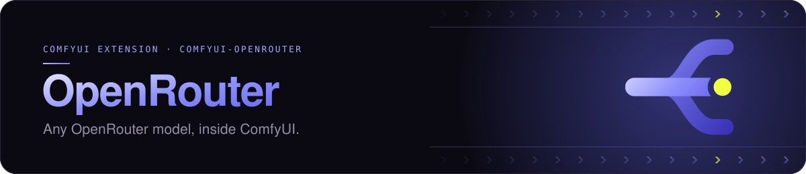

# 

[](#requirements)
[](#requirements)
[](#requirements)
[](LICENSE.md)

Run OpenRouter models in ComfyUI with your own API key: chat, images, video, audio, search, and decisions.

## Requirements

- Python 3.12 or later.
- ComfyUI 0.34.6 or later, with frontend 1.49.6 or a later release before 2.0.
- An OpenRouter API key.

Generation uses your provider account and can incur charges.

## Install

Stop ComfyUI. From its `custom_nodes` folder, clone the extension:

```sh
git clone https://github.com/stefanionescu/comfyui-openrouter.git openrouter
```

In Comfy Desktop, use **Manage > About > Location** to find the installation's
`ComfyUI` folder. Its **Terminal** opens that instance's Python environment.

Install runtime dependencies with the Python that runs ComfyUI.
Choose the command for your installation:

**Comfy Desktop**, in its Terminal:

```sh title="Comfy Desktop terminal, in the ComfyUI folder"
pip install -r custom_nodes/openrouter/requirements.txt
```

**macOS or Linux**, from the ComfyUI folder:

```sh title="In the ComfyUI folder"
.venv/bin/python -m pip install -r custom_nodes/openrouter/requirements.txt
```

**Windows**, in PowerShell from the ComfyUI folder:

```powershell title="In the ComfyUI folder"
.\.venv\Scripts\python.exe -m pip install -r .\custom_nodes\openrouter\requirements.txt
```

**Windows portable**, in PowerShell from the folder containing ComfyUI:

```powershell title="Windows portable parent folder"
.\python_embeded\python.exe -m pip install -r .\ComfyUI\custom_nodes\openrouter\requirements.txt
```

Replace `.venv` if your environment has another name. Restart ComfyUI and
reload its window.

## First run

1. Open **Extensions > OpenRouter > OpenRouter Settings** from the ComfyUI
   menu and save your API key.
2. Add **Chat: Ask** from the **OpenRouter** node menu. Keep its default model
   and write a short question in `prompt`.
3. Connect its `text` output to **Preview as Text**, then select **Run**.
   The answer appears in the preview. This sends one paid chat request.

Cancelling stops the wait; a model can still charge for work it completed.
Accepted video jobs continue. Use **Video: Download** to collect their results.

Change `run_number` to run again with unchanged inputs. For remote or multi-user
setups, see the [access instructions](ADVANCED.md#keys-and-access).

## Example workflows

Open these from **Browse Templates > openrouter**, or load their JSON files.
Read **Start Here** before running. After an update, open examples in a new tab.

| Workflow                                                                                                          | Input                               |
| ----------------------------------------------------------------------------------------------------------------- | ----------------------------------- |
| [Chat: Write a Product Listing](example_workflows/chat-01-write-a-product-listing.json)                           | Two product photos and a spec sheet |
| [Chat: Caption a Training Set](example_workflows/chat-02-caption-a-training-set.json)                             | A folder of images                  |
| [Image: Pick the Best Image for an Occasion](example_workflows/image-01-pick-the-best-image-for-an-occasion.json) | A brief                             |
| [Image: Reject Distorted Images](example_workflows/image-02-reject-distorted-images.json)                         | A subject                           |
| [Image: Edit with the Best Idea](example_workflows/image-03-edit-with-the-best-idea.json)                         | A product photo and a campaign      |
| [Image: Design a Logo](example_workflows/image-04-design-a-logo.json)                                             | A brand description                 |
| [Video: Animate a Product Shot](example_workflows/video-01-animate-a-product-shot.json)                           | A brief                             |
| [Video: Recover a Cancelled Video](example_workflows/video-02-recover-a-cancelled-video.json)                     | A cancelled video job               |
| [Audio: Triage a Voicemail](example_workflows/audio-01-triage-a-voicemail.json)                                   | A voicemail                         |
| [Audio: Dub a Clip](example_workflows/audio-02-dub-a-clip.json)                                                   | A short clip of one speaker         |
| [Search: Answer from Help Articles](example_workflows/search-01-answer-from-help-articles.json)                   | A question and help articles        |
| [Search: Choose a Hero Image](example_workflows/search-02-choose-a-hero-image.json)                               | A brief                             |
| [Decision: Verify a Quick Answer, Then Escalate](example_workflows/decision-01-verify-then-escalate.json)         | Notes and a question                |

The decision examples demonstrate verification, scoring, and conditional
escalation. Start with **Chat: Ask** before building those larger graphs.

## Nodes

Find the nodes under **OpenRouter**. Each linked help page explains its inputs,
outputs, and usage.

| Node                                                                | What it does                                                           | Paid |
| ------------------------------------------------------------------- | ---------------------------------------------------------------------- | ---- |
| [Chat: Ask](web/docs/OpenRouterChatAsk.md)                          | Asks a model, with media or documents, for text, images, or speech.    | Yes  |
| [Chat: Attach Document](web/docs/OpenRouterChatAttachDocument.md)   | Attaches a PDF or text file from ComfyUI's input folder.               | No   |
| [Image: Generate](web/docs/OpenRouterImageGenerate.md)              | Generates or edits images, with masks and SVG files.                   | Yes  |
| [Video: Generate](web/docs/OpenRouterVideoGenerate.md)              | Makes a video from a prompt, frames, or reference media.               | Yes  |
| [Video: Download](web/docs/OpenRouterVideoDownload.md)              | Downloads a video that OpenRouter kept making after a run stopped.     | No   |
| [Audio: Speak](web/docs/OpenRouterAudioSpeak.md)                    | Turns text into speech, optionally in a cloned voice.                  | Yes  |
| [Audio: Transcribe](web/docs/OpenRouterAudioTranscribe.md)          | Turns speech into text, with timed segments, words, and subtitles.     | Yes  |
| [Search: Embed](web/docs/OpenRouterSearchEmbed.md)                  | Turns text and images into embeddings and compares them.               | Yes  |
| [Search: Rank](web/docs/OpenRouterSearchRank.md)                    | Ranks text and images by how well they match a query.                  | Yes  |
| [Decision: Add Question](web/docs/OpenRouterDecisionAddQuestion.md) | Adds a yes-or-no, one-choice, or score question.                       | No   |
| [Decision: Ask](web/docs/OpenRouterDecisionAsk.md)                  | Gets answers with probabilities from a decision model, such as Jev.    | Yes  |
| [Decision: Read Answer](web/docs/OpenRouterDecisionReadAnswer.md)   | Reads one answer as text, a yes flag, and numbers.                     | No   |
| [Request Options](web/docs/OpenRouterRequestOptions.md)             | Sets providers, price limits, and extra request fields for paid nodes. | No   |
| [Model: Info](web/docs/OpenRouterModelInfo.md)                      | Shows what a model reads, makes, and accepts, as JSON.                 | No   |

Use a model ID from [OpenRouter](https://openrouter.ai/models) in `model`.
The model must support the task of the node and connected media. **Model: Info**
shows its listed capabilities. Media sockets accept one item, a batch, or a
list in one request; images keep their individual sizes.
See [model support](ADVANCED.md#models).

Decision nodes use OpenRouter's alpha decisions API, which may change.

## Troubleshooting

| Problem                        | What to check                                                                            |
| ------------------------------ | ---------------------------------------------------------------------------------------- |
| Nodes or templates are missing | Install the complete extension and its requirements with ComfyUI's Python, then restart. |
| The key is rejected            | Check the saved key and any `OPENROUTER_API_KEY` environment value.                      |
| A model or input is rejected   | Inspect the model's capabilities with **Model: Info**.                                   |
| A video outlives ComfyUI       | Collect its recorded job with **Video: Download**.                                       |
| Settings cannot be changed     | Use a direct local connection, or configure credentials on the ComfyUI server.           |

See the [advanced guide](ADVANCED.md#troubleshooting) for request errors and recovery.

[Advanced guide](ADVANCED.md) · [MIT license](LICENSE.md)
